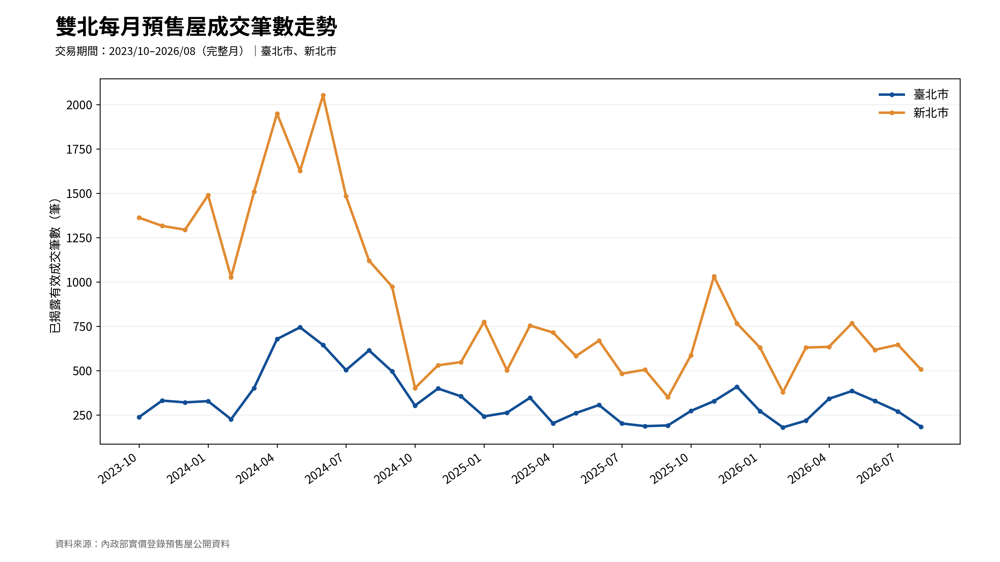
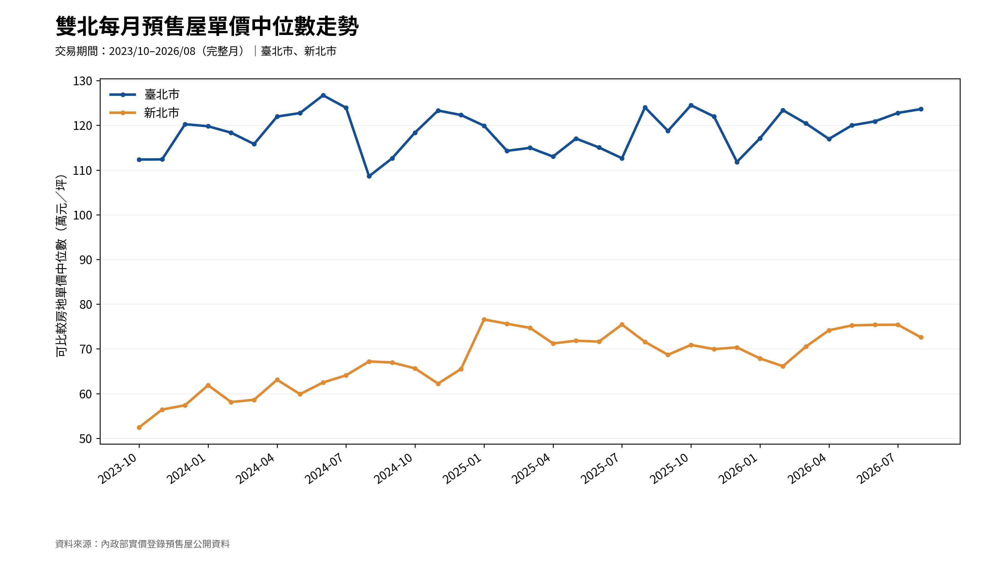
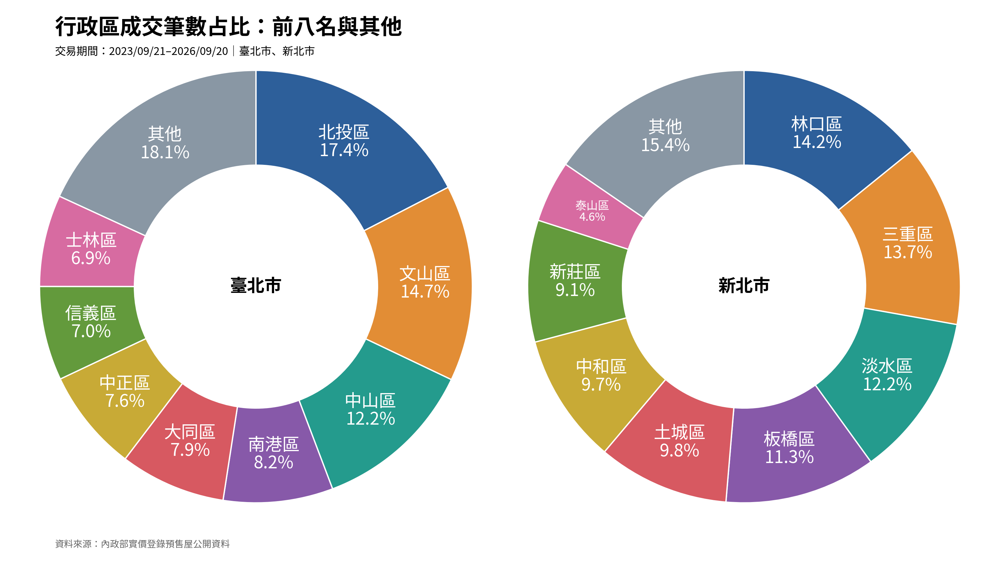
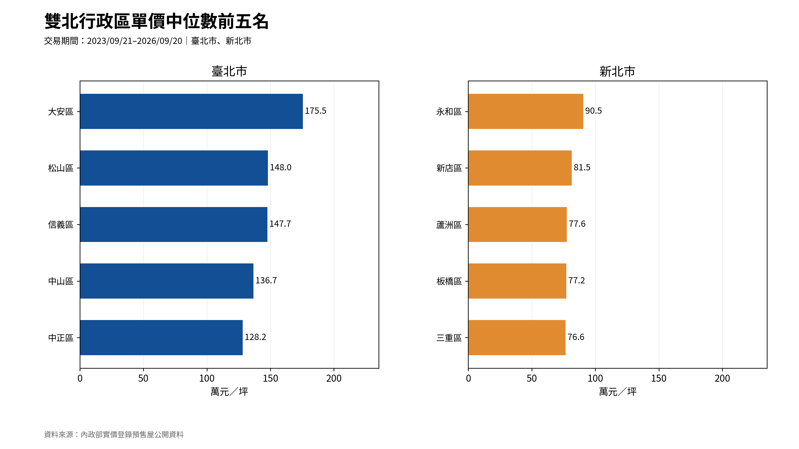
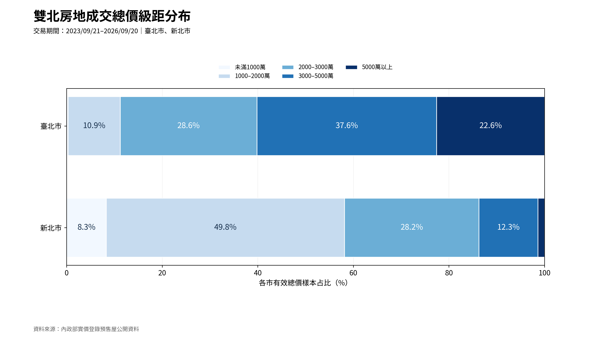
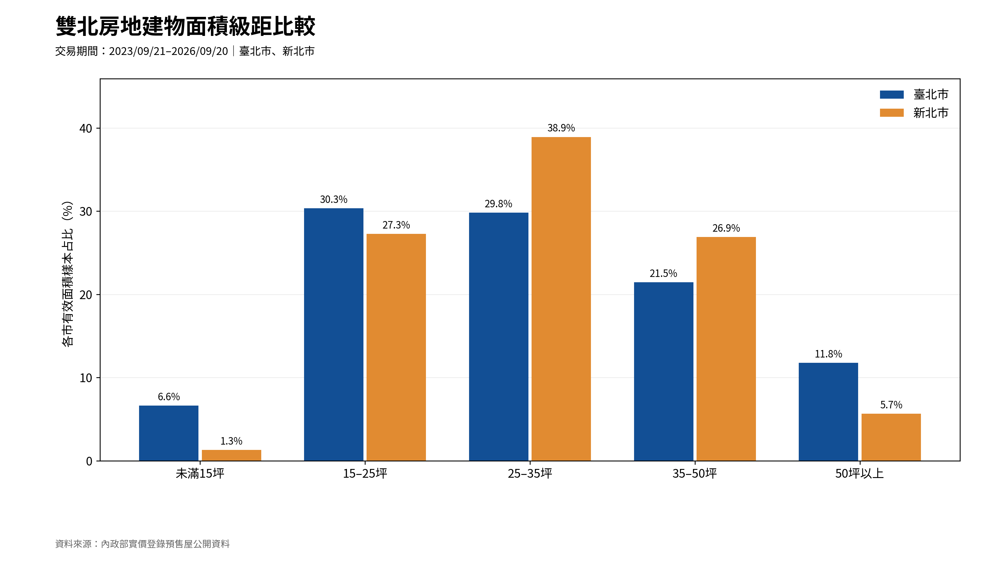
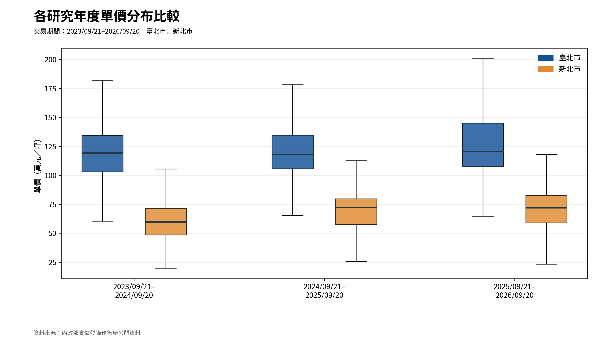
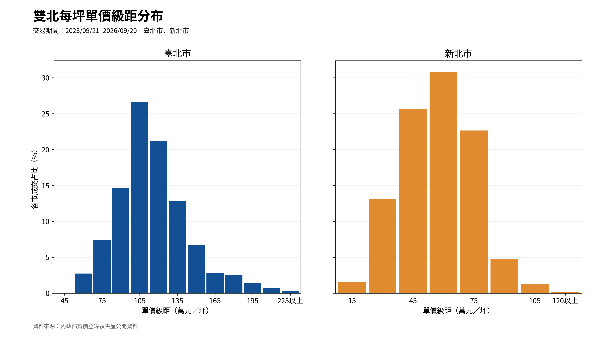

# 雙北市預售屋成交資料分析

**Python · pandas · NumPy · Matplotlib · MySQL**

使用內政部實價登錄預售屋公開 ZIP／CSV，針對臺北市與新北市三年已揭露成交樣本進行讀取、清理、分組統計與視覺化。本專案以 **8 張各有明確分析目的的圖表**，呈現時間變化、行政區差異、成交產品結構與價格分布。

本專案為描述性資料分析與 GitHub 作品展示，**不是**市場價格指數、預測模型、投資建議或全市場成交量調查。

## 研究範圍與有效樣本

| 項目 | 說明 |
|---|---|
| 城市 | 臺北市、新北市 |
| 交易日期 | 2023/09/21 ~ 2026/09/20（含首尾） |
| 完整自然月圖 | 2023/10 ~ 2026/08 |
| 研究年度 | 2023/09/21 ~ 2024/09/20、2024/09/21 ~ 2025/09/20、2025/09/21 ~ 2026/09/20 |
| 資料來源 | 內政部實價登錄預售屋公開批次 |
| 開發環境 | Anaconda、Spyder、MySQL |

依照專案所保存的官方來源批次與資料清理規則，得到以下有效樣本數：

| 指標 | 有效樣本數 |
|---|---:|
| 房地有效成交 | 44,226 筆 |
| 可比較房地單價 | 44,079 筆 |
| 可比較房地總價 | 44,134 筆 |
| 可比較房地建物面積 | 44,134 筆 |

各圖依實際用到的欄位另計有效樣本，不能把上述數字視為所有圖表的相同分母。

## 八張圖表與各自的分析問題

### 1. 時間變化

**01｜每月成交筆數走勢**：哪幾個月份的已揭露有效成交樣本較多？雙北的變化是否相似？



**02｜每月單價中位數走勢**：兩市已揭露預售屋單價中位數在研究期間如何變化？



### 2. 行政區差異

**03｜行政區成交集中程度**：各市交易樣本最多的前八名行政區合計占多少？其餘合併為「其他」。



**04｜行政區單價中位數排行**：各市哪些行政區的單價中位數較高？僅列入單價有效樣本至少 30 筆的行政區，各市取前五名。



### 3. 房地總價與面積結構

**05｜房地成交總價級距占比**：三年合併後，兩市各以哪個房地總價區間為主？



**06｜房地建物面積級距占比**：各市成交住宅的建物面積主要分布在哪些級距？



### 4. 單價的統計分布

**07｜城市與研究年度單價箱型圖**：各市不同研究年度的單價中位數與分散程度有何差異？



**08｜每坪單價級距分布**：各市每坪單價主要集中在哪些區間？



[完整圖表索引](docs/chart_catalog.md) · [實際統計與解讀](docs/analysis_notes.md) · [八圖彙總統計](charts/eight_chart_summary.csv)

## 資料處理流程

```text
內政部官方 ZIP／CSV
    ↓
src/read_official_data.py        來源批次讀取與檢查
    ↓
src/filter_transactions.py      雙北市與研究期間篩選
    ↓
src/clean_transactions.py     解約、備註、重複資料、車位計算口徑
    ├──────────→ src/import_to_mysql.py + database/*.sql（SQL 核對）
    ↓
src/create_charts.py           八張圖及彙總統計 CSV
    ↓
src/prepare_chart_assets.py   圖表清單與尺寸檢查
```

## 使用 Anaconda + Spyder 重現

1. 使用 Anaconda 確保已安裝 `pandas`、`numpy`、`matplotlib`、`Pillow`；需要 MySQL 時另安裝 `mysql-connector-python`，並準備 MySQL Server。
2. 由[內政部實價登錄公開資料下載入口](https://plvr.land.moi.gov.tw/DownloadOpenData)取得涵蓋本研究期間的預售屋批次 ZIP，放入 `data/raw/`，保留原始壓縮檔及來源紀錄。
3. 於 Spyder 依序執行 `src/read_official_data.py`、`src/filter_transactions.py`、`src/clean_transactions.py`；核對日期、來源數量、排除條件與有效樣本數。
4. 執行 `src/create_charts.py`，在 `charts/` 取得八張 PNG 和 `eight_chart_summary.csv`、`research_year_statistics.csv`、`full_month_statistics.csv`。
5. 執行 `src/prepare_chart_assets.py`，確認 `docs/chart_catalog.md`、`docs/chart_inventory.csv` 列示八張圖表。
6. 需要資料庫驗算時，可依序使用 `database/schema.sql`、`src/import_to_mysql.py` 與 `database/analysis_queries.sql`；MySQL 密碼以執行時輸入，不放入程式或公開檔案。

## 程式閱讀重點

本專案依照資料處理順序安排六支 Python 程式，主要使用基本變數、`if`、`for` 與 pandas 常用操作。程式內附繁體中文註解，方便沿著資料流程閱讀：

- `read_official_data.py`：使用 `zipfile` 開啟政府 ZIP、`pandas.read_csv()` 讀取 CSV，並建立來源紀錄。
- `filter_transactions.py`：將民國日期轉為西元日期，使用 `between()` 篩選研究期間。
- `clean_transactions.py`：用布林條件檢查解約、重複與車位資料，再以 `groupby()` 計算統計量。
- `create_charts.py`：從清理後的 CSV 取出有效樣本，依月份、行政區及級距分組，使用 Matplotlib 繪製八張圖。
- `import_to_mysql.py`：使用 `executemany()` 批次匯入資料，並將 SQL 的統計結果與 pandas 核對。
- `prepare_chart_assets.py`：檢查 PNG 尺寸並整理圖表索引。

行政區圓環圖的字級依目前資料的扇區占比設定；若重新下載官方批次而改變分布，應在 Spyder 重新檢查文字是否超出扇區。正式圖表輸出維持 3200 × 1800 像素。

## 統計口徑與限制

- **成交筆數**：已揭露、通過清理條件的房地或房地＋車位交易筆數；非全市場總成交量，也非不同建案件數。
- **房地單價**：使用清理後 `統計單價_萬元坪`，由官方單價轉換、排除不可比較的車位資料及無效值。
- **房地總價與建物面積**：使用清理後的 `房地總價_萬元`、`房地建物面積_坪`，已扣除**可明確拆分**車位價金及面積；不可拆分樣本不列入相應比較。建物面積仍含共有部分，不等於室內實際使用面積。
- **行政區圖**：成交占比以各市有效交易筆數為分母，顯示前八名與其他；價格排行仍各列前五名，並採單價有效樣本門檻。
- **分布圖**：箱型圖在圖面上不顯示離群點符號；單價級距圖依城市採每 15 萬元／坪的分類，最後一組為「以上」，所有有效單價資料均計入，並以各市樣本換算百分比。不同城市的級距起點可能不同，不宜直接逐柱比較。
- **資料揭露**：歷史批次可能受揭露延遲、後續更正及解約更新影響，樣本變化不能單憑本圖表推論政策因果或同質房價漲跌。

## 資料來源

[內政部不動產交易實價查詢服務網](https://lvr.land.moi.gov.tw/) · [官方批次公開資料下載](https://plvr.land.moi.gov.tw/DownloadOpenData)

原始官方 ZIP、交易層級 CSV、來源清單及私人專案管理文件均保留於本機。專案採用**單一完整資料夾**，以根目錄 `.gitignore` 排除 `data/`、私人文件與機密設定；GitHub 只提交可公開的程式碼、八張圖、彙總統計及說明文件。請勿將完整專案 ZIP 直接上傳到 GitHub。 若先前已有檔案被 Git 追蹤，`.gitignore` 不會自動取消追蹤，提交前請先檢查 GitHub Desktop 的 Changes 清單。
