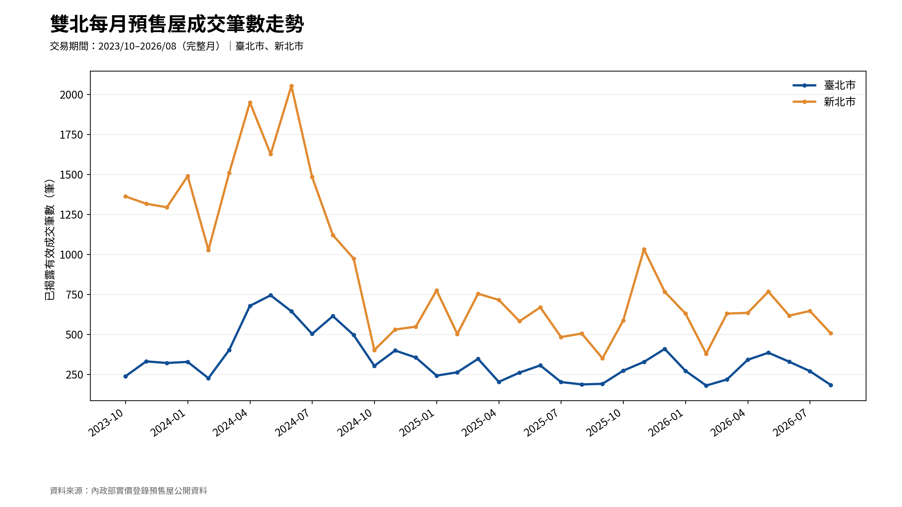
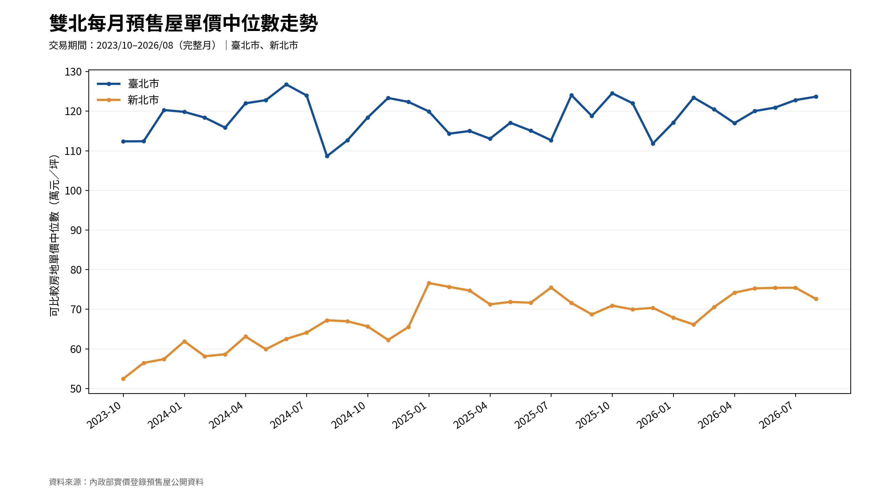
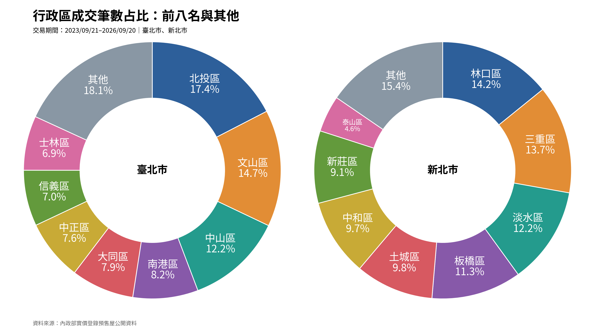
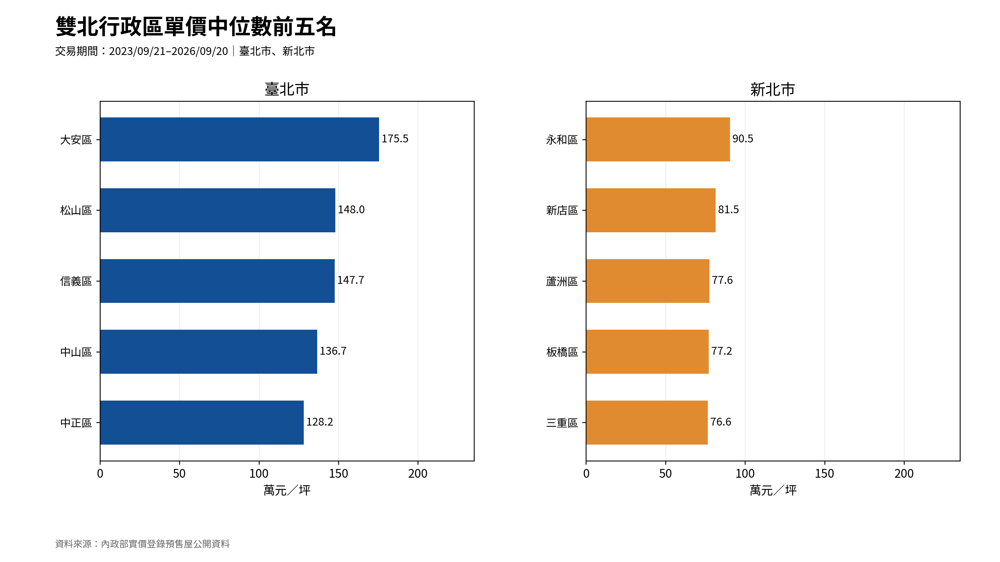
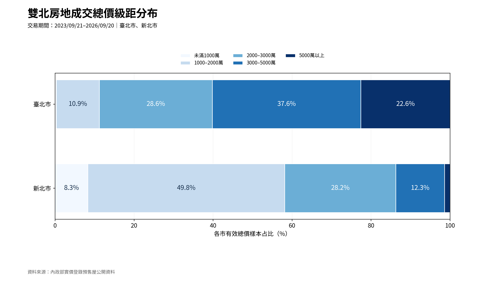
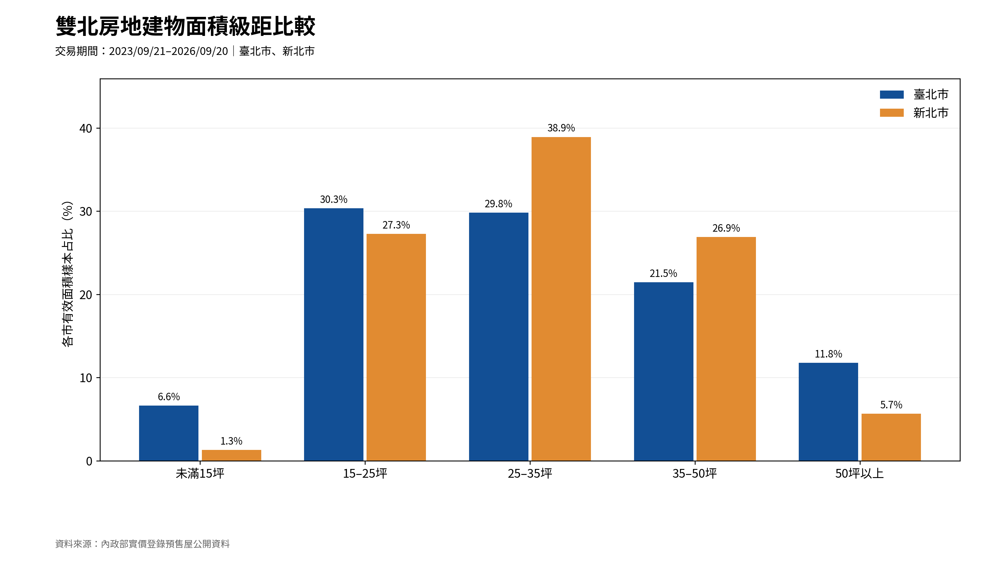
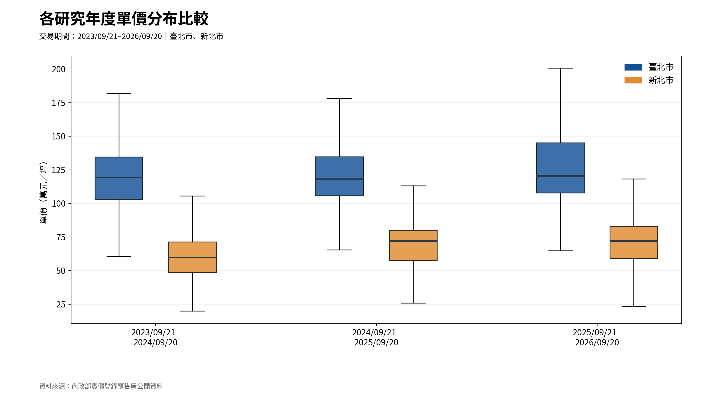
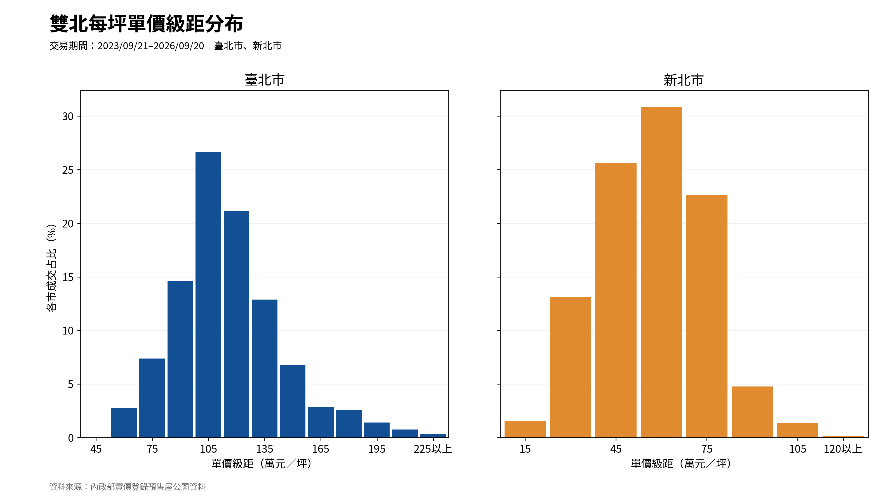

# 雙北預售屋成交分析｜八張圖表索引

- **地區**：臺北市、新北市。
- **研究期間**：2023/09/21～2026/09/20（依交易日期）。
- **完整自然月圖**：2023/10～2026/08。
- **資料來源**：內政部實價登錄預售屋公開批次資料。
- **統計對象**：依本專案既有清理規則取得的有效揭露交易；非全市場成交總量。

## 圖表與分析目的

### 01｜每月成交筆數走勢

**分析問題：**已揭露有效成交筆數如何逐月變化？

### 02｜每月單價中位數走勢

**分析問題：**雙北單價中位數如何隨月份變化？

### 03｜行政區成交集中程度

**分析問題：**各市前八名行政區合計占多少成交樣本？

### 04｜行政區單價中位數排行

**分析問題：**哪些行政區的房地單價中位數較高？

### 05｜房地成交總價級距

**分析問題：**各市已揭露成交樣本以哪個房地總價帶為主？

### 06｜房地建物面積級距

**分析問題：**各市已揭露成交樣本主要集中在哪個建物面積級距？

### 07｜城市與研究年度單價箱型圖

**分析問題：**不同城市與研究年度的單價分布差異如何？

### 08｜單價級距分布圖

**分析問題：**各市每坪單價集中在哪些級距？

## 相關統計表

- [`charts/eight_chart_summary.csv`](../charts/eight_chart_summary.csv)
- [`charts/full_month_statistics.csv`](../charts/full_month_statistics.csv)
- [`charts/research_year_statistics.csv`](../charts/research_year_statistics.csv)

## 圖表口徑與注意事項

- 每張圖的樣本數依指標的有效值而定；單價、房地總價、面積可能不同。
- 單價使用清理後的官方房地單價；房地總價與建物面積扣除可明確拆分的車位部分。
- 行政區成交占比以各城市全部有效交易筆數為分母；『其他』包含未列出的行政區。
- 單價排行只採有效單價樣本至少 30 筆的行政區。
- 房地建物面積仍包含共有部分，不是室內實坪。
- 箱型圖不顯示極端點符號，但仍以全部有效樣本計算統計值。
- 單價級距圖採每 15 萬元／坪一級距，另以開放式末端級距收納全部更高價格，沒有排除任何單價樣本。
- 價格及交易量受到已揭露資料與個案組成影響，不能推論為價格指數或因果效果。

各圖的真實數值與解讀可參閱 [分析說明](analysis_notes.md)。
